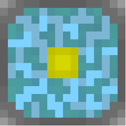

<p align="center">
  
  <br>
  <b>Reactium - A Legacy-Inspired Nukkit Fork</b>
  <br><br>
  <a href="LICENSE"></a>
  <a href="https://github.com/ReactiumMC/Reactium/releases"></a>
</p>


Reactium is a Minecraft: Bedrock Edition server software, forked from [Cloudburst Nukkit](https://github.com/CloudburstMC/Nukkit).

## Philosophy

- **Built on proven ground** - Reactium inherits Nukkit's performance-oriented architecture rather than starting from scratch.
- **Open and modifiable** - released as open source so the community can extend, fork, and adapt it.

## 🚧 Current Status
In development - expect bugs, glitches or missing features.


## 📦 Installation

```bash
git clone https://github.com/ReactiumMC/Reactium.git
cd Reactium
./gradlew shadowJar
```

## 🤝 Contributing

Contributions are welcome! Please open an issue to discuss significant additions before submitting a PR, so we can keep the scope aligned with the project's goals.

## 📜 License

This project is a fork of Cloudburst Nukkit and retains its original license. See [LICENSE](LICENSE) for details.

## Credits

- [Cloudburst Nukkit](https://github.com/CloudburstMC/Nukkit)
